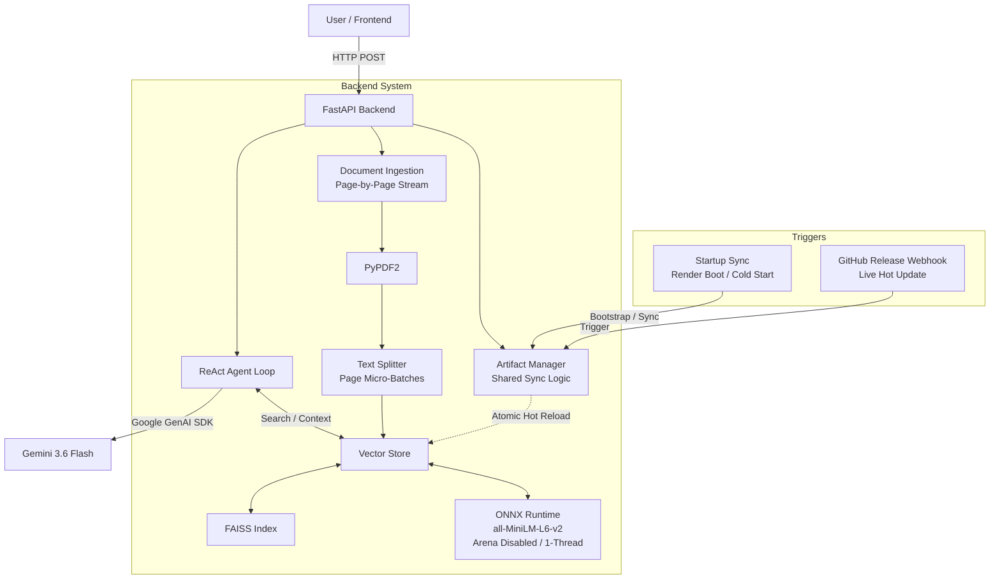

# 🧠 System Architecture

Aegis was intentionally designed to avoid heavy abstractions (like LangChain or LlamaIndex). By building the core
components from scratch, the system remains highly performant, customizable, and educational.

## System Diagram

## Core Components

### 1. The ReAct Agent (`src/agent.py`)

Aegis uses the **ReAct (Reason + Act)** prompting framework paired with **Gemini 3.6 Flash**. Instead of a single API
call to generate an answer, the Agent operates in a loop:

1. **Thought:** The LLM reasons about what to do next based on the user's prompt.
2. **Action:** The LLM selects a specific tool (e.g., `vector_search`).
3. **Action Input:** The LLM generates the arguments for the tool.
4. **Observation:** The Python backend executes the tool and injects the result back into the LLM's prompt.
5. **Final Answer:** Once the LLM has enough information, it breaks the loop and delivers the grounded answer.

### 2. Local ONNX Embeddings (`src/vector_store.py`)

Standard embedding pipelines require massive libraries like PyTorch. Aegis solves this by exporting the HuggingFace
model (`all-MiniLM-L6-v2`) into a highly optimized, quantized `INT8` ONNX format.

To support memory-constrained environments like **Render's 512 MB Free Tier**:

* **Arena Disabled:** `enable_cpu_mem_arena` is set to `False` to prevent ONNX Runtime from pre-allocating large dynamic
  memory pools.
* **Single Threading:** `intra_op_num_threads` and `inter_op_num_threads` are pinned to `1` to avoid thread-pool
  allocation overhead.
* **Result:** Embeddings run entirely locally on the CPU using `onnxruntime`, flatlining system RAM and executing in
  milliseconds without network latency.

### 3. In-Memory FAISS Vector DB & Page-Streaming Ingestion

Aegis uses Facebook's FAISS `IndexFlatIP` for vector similarity search.

* **Incremental Streaming (`src/api.py`):** Rather than reading full PDFs into Python strings, text is extracted
  page-by-page. Micro-batches of vectors ($N=2$) are pushed directly to FAISS before deleting page buffers and
  triggering explicit garbage collection (`gc.collect()`).
* **Querying:** When the Agent calls `vector_search`, FAISS performs a cosine-similarity check against the query and
  returns the top relevant chunks decorated with citations (e.g., `[Source: doc.pdf]`).

### 4. Stateless BYOK Auth Strategy

To ensure maximum user privacy and ease of deployment:

* Aegis requires zero database setup for authentication.
* Users provide their own Gemini API key dynamically via the UI (`type="password"`).
* Browser password managers naturally save this key for a frictionless UX.
* The API backend processes the key statelessly per request; it is never logged or stored.

### 5. Zero-Downtime Artifact Delivery Pipeline

Aegis fully decouples **Application Deployments** (Render/Docker) from **Inference Artifact Deployments** (models,
tokenizers, configs).

* **GitHub Actions Integration:** When a new release is triggered via GitHub Actions (UI or CLI), the workflow
  automatically exports the ONNX artifacts, creates a release, and sends a webhook payload to the backend.
* **Asynchronous Streaming:** The `ArtifactManager` downloads large binary ONNX files to a `temp/` directory without
  blocking the main event loop.
* **Idempotency & Integrity Check:** Downloads are strictly locked (no race conditions) and versions are verified.
* **Atomic Hot Swap:** `VectorMemory` loads the new artifacts into memory using low-RAM session flags. If validation
  passes, a native Python pointer swap replaces the active runtime models instantaneously. Live inference requests are
  never interrupted.
* **Automatic Rollback:** If any file is corrupted or validation fails, the update aborts, preserving the current
  working state.

### 6. Bootstrap & Startup Recovery

On the very first application deployment, there may be no local artifacts available. The application must not attempt to
initialize the inference runtime before ensuring artifacts exist.

Aegis handles this via a unified `sync_artifacts()` flow:

* **First Deployment:** Bootstraps by downloading the latest GitHub Release before loading the runtime.
* **Render Redeploy:** If container restarts and local storage is lost, it automatically recovers by pulling the latest
  release.
* **Shared Logic:** Both the webhook hot-update and the startup sync use the exact same validation and atomic swapping
  mechanism, ensuring identical failure handling.

---

## Edge Cases Handled

| Situation                             | Handling                                                                                                      |
|---------------------------------------|---------------------------------------------------------------------------------------------------------------|
| First deployment with no artifacts    | Bootstrap by downloading the latest GitHub Release before loading the runtime                                 |
| Duplicate webhook                     | Ignore if version already active                                                                              |
| Older release received                | Ignore                                                                                                        |
| Partial download                      | Abort update                                                                                                  |
| Corrupted artifact                    | Abort update                                                                                                  |
| Checksum mismatch                     | Abort update                                                                                                  |
| Missing artifact                      | Abort update                                                                                                  |
| Runtime cannot load                   | Roll back immediately                                                                                         |
| API restart                           | Startup synchronization restores latest release before runtime initialization                                 |
| Render redeploy / new container       | Bootstrap from latest release if local artifacts are unavailable                                              |
| Multiple concurrent webhook calls     | Serialize updates with a lock to prevent race conditions                                                      |
| Requests during update                | Continue using current runtime until new runtime is ready                                                     |
| Interrupted download                  | Keep current artifacts unchanged                                                                              |
| Network failure                       | Retry with backoff or continue serving existing version                                                       |
| GitHub API temporarily unavailable    | Retry later; do not replace current artifacts                                                                 |
| Release missing expected assets       | Reject release and log error                                                                                  |
| Version already deployed              | Skip update                                                                                                   |
| Hot reload fails after files replaced | Restore previous artifacts and previous runtime                                                               |
| Large artifacts                       | Stream downloads instead of loading entire files into memory                                                  |
| Large document uploads (PDFs)         | Incremental page-by-page streaming + micro-batching ($N=2$) to prevent OOM crashes on 512 MB RAM environments |

---
